# Recuperação da central multimídia 9" do Fiat Argo (Multilaser / Mopar)

Guia passo a passo e imagem de fábrica para **reinstalar o Android** da central multimídia original de 9"
do Fiat Argo quando ela fica **presa na tela "Android system recovery"** (robô verde deitado com
triângulo vermelho) e não volta mais para a tela normal.

**Funcionou de verdade:** em 18/11/2026 uma central presa no recovery voltou ao Android normal
seguindo exatamente este guia (fotos abaixo são desse conserto).

> **Projeto não oficial**, feito por dono para dono, sem vínculo com Fiat, Stellantis ou Multilaser.
> O software pertence aos fabricantes. Use por sua conta e risco. Se a sua central ainda está na
> garantia, procure a concessionária primeiro.

## Por que isto é público e de graça

Quando a minha central travou, fui atrás de conserto:

- Nas **concessionárias**, queriam cobrar **R$ 500 só pelo pré-diagnóstico**, sem garantia nenhuma de
  que teriam a solução.
- Em **lojas de som**, o conserto saía por volta de **R$ 1.000**.
- A imagem do sistema não existia em lugar nenhum da internet, e nem a Multilaser nem as concessionárias
  tinham o arquivo.

Depois de conseguir clonar uma central igual e consertar a minha, achei que isso **deveria ser público**,
para ninguém mais ter que pagar caro (ou trocar a central) por um problema que se resolve com um cartão
de memória e uns 30 minutos.

### Apoie este projeto (Pix)

Achou interessante ou este guia salvou a sua central? Foram horas descobrindo o formato do recovery,
clonando uma central igual e testando o conserto, tudo publicado **de graça**. Quem quiser ajudar,
ajuda no Pix, com qualquer valor:

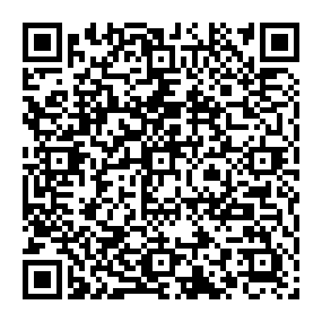

**Chave Pix (aleatória):** `88f688c6-5d31-4bbb-b969-b8dcc42aa73a`

**Pix copia e cola:**

```
00020126580014BR.GOV.BCB.PIX013688f688c6-5d31-4bbb-b969-b8dcc42aa73a5204000053039865802BR5919DOACAO ARGO CENTRAL6006BRASIL62070503***6304E501
```

No app do banco: **Pix > Ler QR code** ou **Pix copia e cola**, escolha o valor e confirme.
O app mostra o nome do titular da chave antes de você confirmar. Obrigado! 🙏

---

## Índice

1. [Qual central é esta](#1-qual-central-é-esta)
2. [O problema que este guia resolve](#2-o-problema-que-este-guia-resolve)
3. [O que você precisa](#3-o-que-você-precisa)
4. [Passo a passo](#4-passo-a-passo)
   - [Cenário 2: pela tela "Atualização do sistema", com pendrive](#cenário-2-pela-tela-atualização-do-sistema-com-pendrive)
5. [O que NÃO fazer](#5-o-que-não-fazer)
6. [Mensagens que podem aparecer](#6-mensagens-que-podem-aparecer)
7. [O que essa imagem faz e não faz](#7-o-que-essa-imagem-faz-e-não-faz)
8. [Conferência do arquivo (MD5)](#8-conferência-do-arquivo-md5)
9. [Como a imagem foi feita](#9-como-a-imagem-foi-feita)
10. [Detalhes técnicos](#10-detalhes-técnicos-para-quem-quer-ir-além)
11. [Apoie este projeto](#apoie-este-projeto)

---

## 1. Qual central é esta

É a central **original de fábrica de 9"** do Fiat Argo, fabricada pela **Multilaser** e vendida pela
**Mopar** (peça FCA `52128799`). Por dentro é um Android 4.2.2 com processador Autochips AC8317
(projeto Roadrover).

### Como ela é no painel

Tela de 9" "flutuante" no alto do painel do Argo, com os botões **PWR**, **HOME** e **BACK** (e o furo
do **MIC**) na lateral esquerda. Nesta foto ela está justamente presa no recovery, o problema que este
guia resolve:

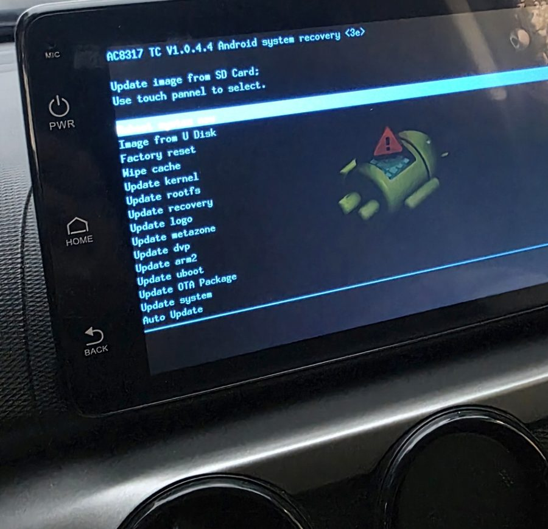

### Como ela é na tela

Tela inicial com relógio grande e a barra de baixo com **Rádio, Telefone, BT Música, Apps, Músicas,
Vídeo e Config**, faixas vermelhas/laranja:

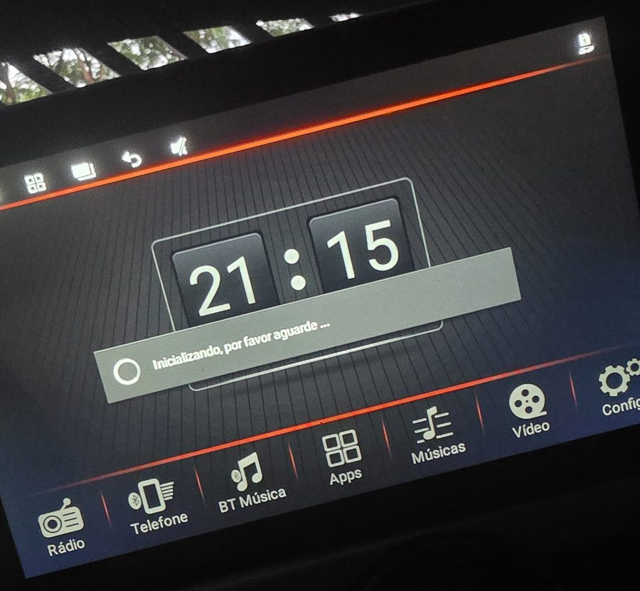

### Confira a versão do software

Se a central ainda ligasse, a versão aparece em **Config > Sobre / Informações do sistema**:

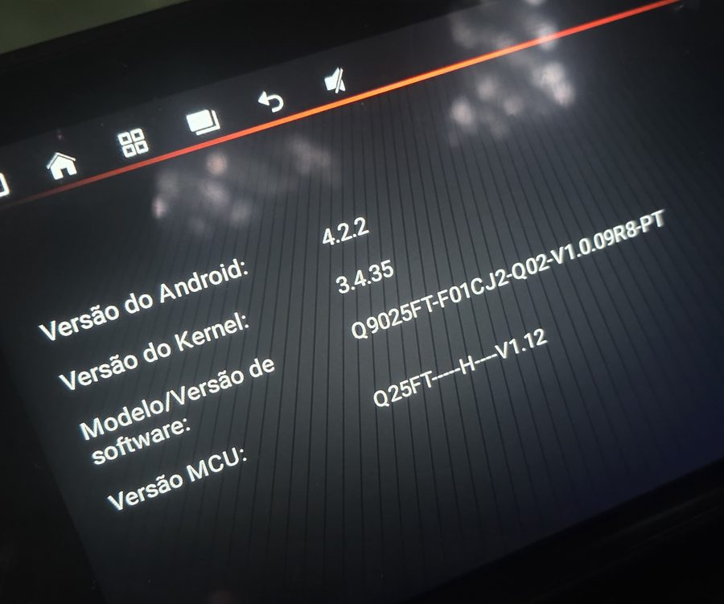

| Campo | Precisa ser |
|---|---|
| Versão do Android | `4.2.2` |
| Versão do Kernel | `3.4.35` |
| Modelo/Versão de software | **`Q9025FT-F01CJ2-Q02-V1.0.09R8-PT`** |
| Versão MCU | `Q25FT---H---V1.12` |

### Confira a etiqueta (atrás da central)

Se ela já não liga, tire a central do painel e veja a etiqueta branca de trás
(número de série borrado nesta foto).

**Como tirar a central do painel:** vídeo
["como tirar a central multimídia do fiat argo"](https://www.youtube.com/watch?v=ZVi6xamriGQ),
do canal **Dicas da Hora som e acessórios** (crédito ao autor; o vídeo não é deste projeto):

[](https://www.youtube.com/watch?v=ZVi6xamriGQ)

Foto da etiqueta:

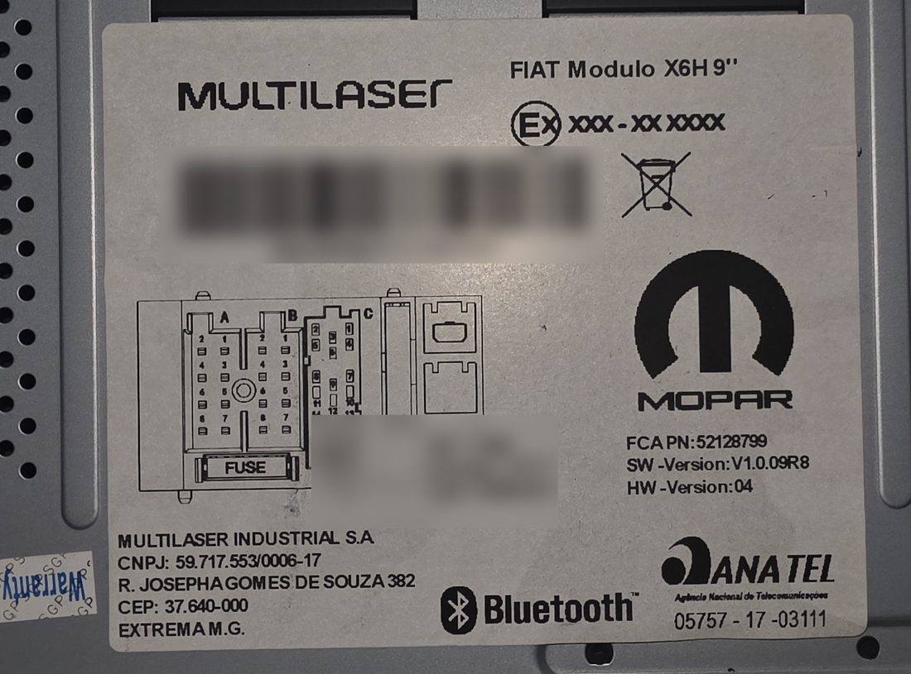

| Campo da etiqueta | Precisa ser |
|---|---|
| Fabricante | **MULTILASER** |
| Produto | **FIAT Modulo X6H 9"**, logo **MOPAR** |
| FCA PN | **`52128799`** |
| SW-Version | **`V1.0.09R8`** |
| HW-Version | `04` (testado nesta) |
| Anatel | `05757-17-03111` |

Na carcaça de metal também vem gravado `Q9014FT16A V0`.

### Confira a tela do recovery

A primeira linha da tela de recovery tem que ser **`AC8317 TC V1.0.4.4 Android system recovery <3e>`**
e o menu tem que ter estas opções:

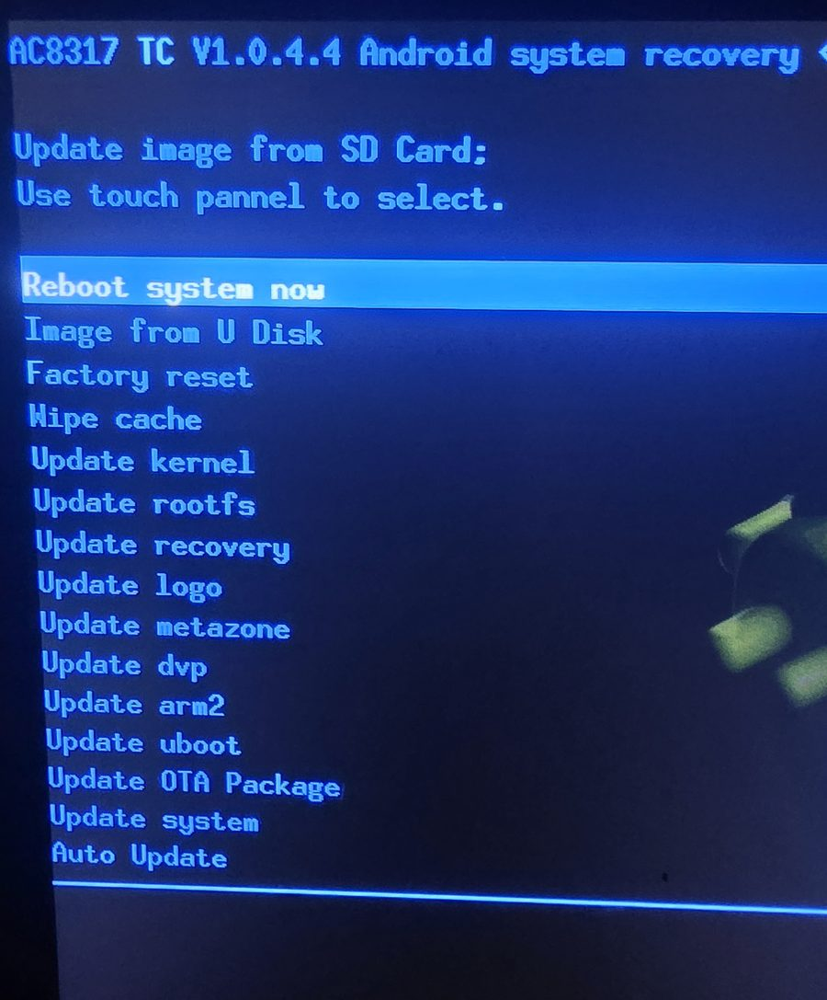

> **Se qualquer item acima for diferente** (outra versão de software, outra etiqueta, outro menu),
> **não use esta imagem**. Ela é só para a `V1.0.09R8`.

---

## 2. O problema que este guia resolve

A central liga e, em vez da tela normal, cai sempre na tela do **Android system recovery** com o robô
verde e o triângulo vermelho. "Reboot system now" volta para a mesma tela. "Wipe cache", "Factory reset"
e desligar a bateria do carro **não resolvem**.

Isso acontece quando algum arquivo da **partição `system`** (onde fica o Android) foi apagado, trocado
ou corrompido: o Android não consegue iniciar e o aparelho cai no recovery. No caso que deu origem a este
guia, três bibliotecas do sistema tinham sido sobrescritas.

A solução é **regravar a partição `system` com a de fábrica**. O próprio recovery da central faz isso,
pela opção **Update system**, lendo um arquivo do cartão de memória colocado na entrada do **módulo**
(a caixa atrás da tela). Este repositório fornece esse arquivo.

---

## 3. O que você precisa

- **Cartão micro SD de 4 a 32 GB** (vai na entrada do **módulo atrás da tela**; o leitor é antigo e acima de 32 GB pode não ser reconhecido).
- Um **computador** para preparar o cartão.
- O arquivo **`system.img.ext4.zip`** (357 MB) da página de
  [Releases](https://github.com/gustavomorozi/argo-central-recuperacao/releases/latest).
- Ferramentas para **tirar a central do painel** (veja o vídeo abaixo).
- Uns **30 minutos** com o carro parado e ligado (ou com a bateria boa).

> **Onde fica a entrada do cartão:** a gravação é feita pelo **cartão de memória**, e a entrada de
> cartão **não fica na tela**. Atrás da tela tem um **módulo** (a caixa de metal da central), e é nesse
> módulo que fica a entrada para o cartão micro SD. Por isso é preciso **tirar a central do painel**
> para chegar no módulo: veja o [vídeo de como tirar](https://www.youtube.com/watch?v=ZVi6xamriGQ),
> do canal Dicas da Hora som e acessórios. Aproveite e confira a etiqueta do módulo
> ([seção 1](#confira-a-etiqueta-atrás-da-central)).
>
> Com o cartão colocado no módulo, a central precisa estar **ligada no chicote do carro** para você usar
> a tela do recovery. Se os cabos alcançarem, dá para fazer com ela apoiada fora do painel; se não,
> encaixe a central de volta (com o cartão dentro) e faça o procedimento normalmente.

---

## 4. Passo a passo

### Parte A: preparar o cartão (no computador)

1. Baixe **`system.img.ext4.zip`** da página de
   [Releases](https://github.com/gustavomorozi/argo-central-recuperacao/releases/latest).
2. (Recomendado) Confira o MD5 do arquivo baixado (veja a [seção 8](#8-conferência-do-arquivo-md5)).
3. **Descompacte** o zip. Sai **um arquivo só**: `system.img.ext4` (839 MB).
4. Coloque o cartão no computador e **formate em FAT32**
   (Windows: Explorador de Arquivos, clique com o botão direito no cartão > **Formatar** > Sistema de
   arquivos **FAT32** > Iniciar). Isso apaga tudo que estiver no cartão.
5. Copie **`system.img.ext4`** para a **raiz** do cartão.
   - **Não** coloque dentro de pasta.
   - **Não** renomeie (tem que ser exatamente `system.img.ext4`).
6. **Ejete** o cartão com segurança antes de tirar.

### Como entrar no recovery

- Se o Android da central estiver estragado, ela **já abre sozinha** no recovery ao ligar.
- Se o Android **ainda liga** (mesmo com erro, por exemplo "o launcher parou"), o jeito que funciona é
  pelo **ADB por Wi-Fi**: com a central e um computador na mesma rede Wi-Fi, rode
  `adb connect IP-DA-CENTRAL:5555` e depois `adb reboot recovery` (o IP aparece em Configurações > Wi-Fi).
  Sem computador, dá para mandar o mesmo `reboot recovery` do celular com um app de ADB (por exemplo,
  Bugjaeger), conectando no IP da central, porta 5555.
- **O botão de reset não entra no recovery.** Testamos: ele só reinicia a central, apertando ou
  segurando. Analisando o bootloader, a central até tem uma tecla de recovery na hora de ligar, mas ela
  não está ligada a nenhum botão do painel do Argo (nem volume, nem reset, nem a tela).
- A tela **Configurações > Atualização do sistema** também reinicia no recovery, mas só libera o botão
  quando acha uma pasta `update` com `update.img` e `hwversion.txt` (versão maior que a atual) no cartão
  ou pendrive. Sem esses arquivos ela mostra "Nenhuma atualização disponível".

### Parte B: na central

1. **Tire a central do painel** para chegar no **módulo** atrás da tela
   ([vídeo de como tirar](https://www.youtube.com/watch?v=ZVi6xamriGQ)).
2. **Coloque o cartão** na entrada de cartão de memória **do módulo** (atrás da tela, não na tela) e
   deixe a central ligada no chicote do carro (fora do painel, se os cabos alcançarem, ou encaixada de volta).
3. Ligue o carro. A central vai abrir no recovery (o menu da [foto acima](#confira-a-tela-do-recovery)).
4. Confira que o título do menu diz **"Update image from SD Card"**.
   Se estiver dizendo "USB Disk", toque em **Image from U Disk** para alternar de volta para o SD.
5. Toque em **Update system** (é a **penúltima** opção, logo acima de "Auto Update").
6. A central mostra `Update system ...` e a linha
   `update_ext4_partition_from_file dev(/dev/block/system) offset(0x0) file(/ext_sdcard2/system.img.ext4)`.
   Ela está gravando:

   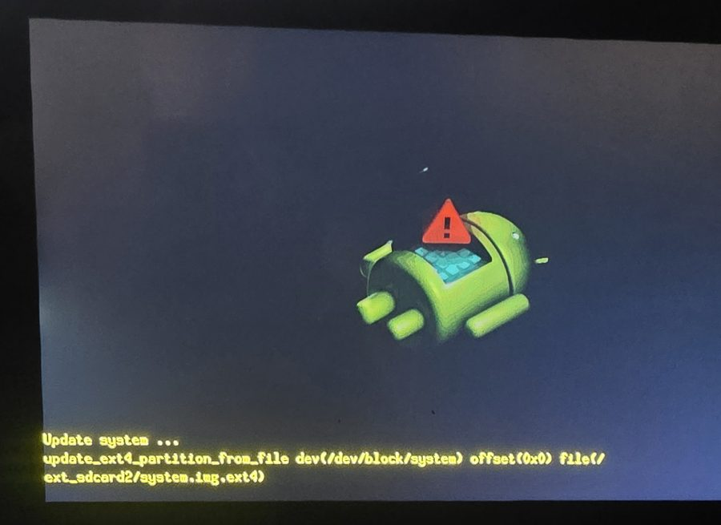

   **Espere de 2 a 10 minutos.** Não desligue o carro, não tire o cartão do módulo e não toque na tela.
   É normal a tela ficar parada nessa linha.
7. Quando terminar aparece **"Update system from /ext_sdcard2/. Update is successful."** e
   `update_ext4_partition_from_file succeeded!`:

   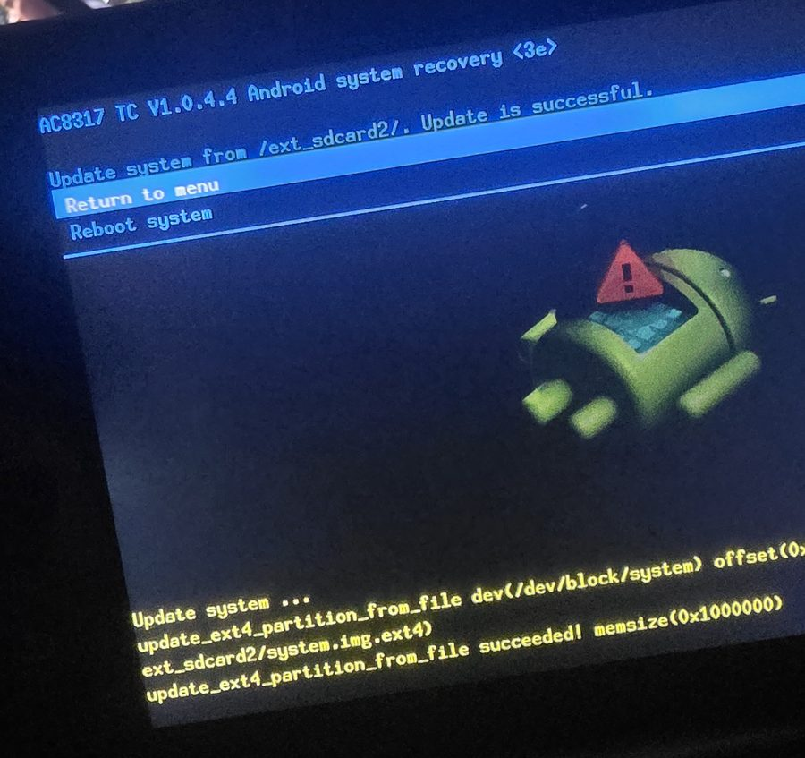

8. Toque em **Reboot system**. Pode deixar o cartão dentro.
9. O **primeiro boot demora mais** (de 3 a 10 minutos): aparece "Aguarde, sistema inicializando..."

   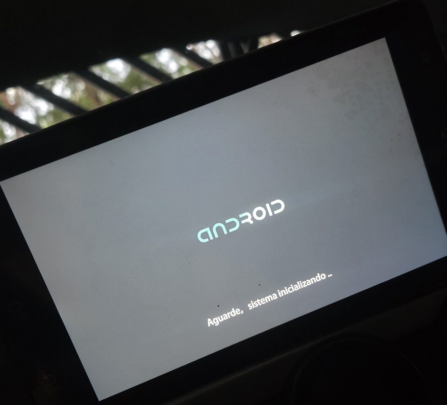

   e depois a tela inicial com "Inicializando, por favor aguarde...". Espere esse aviso sumir.
10. Pronto. Depois tire o cartão do módulo e coloque a central de volta no painel.

### Cenário 2: pela tela "Atualização do sistema", com pendrive

> ✅ **Testado e funcionando** (27/11/2026): a tela levou ao recovery, ele leu o pacote, conferiu o MD5,
> gravou o sistema e a central voltou ao normal. **Por sua conta e risco**, como todo o guia.
>
> 💾 **Por esta tela, só funciona com PENDRIVE** na USB da central (o cartão de memória do módulo não é
> reconhecido por ela). Se a central não liga mais o Android, use o **cenário 1** (pelo menu do recovery,
> com o cartão no módulo).

Serve para quando a central **ainda liga o Android** (mesmo com erros, "o launcher parou", lenta,
travando) e você quer regravar o sistema de fábrica **sem tirar a central do painel**: tudo por
**pendrive**, pela tela de atualização da própria central.

> ⚠️ **Apaga tudo**, como um padrão de fábrica: apps instalados, configurações, Wi-Fi salvo e
> pareamentos Bluetooth (o recovery limpa `/data`, `/data4write` e `/cache` no fim). A licença do
> sistema e o assistente de voz são preservados. O recovery da central **não** é regravado (é igual) e a
> tabela de partições **não** é mexida (é igual).

**Precisa de:** um **pendrive formatado em FAT32** (exFAT/NTFS a central não lê) e os dois arquivos da release
[**Cenário 2: atualização pela tela**](../../releases/tag/v1.0.09R8-tela): `update.img` (580 MB) e
`hwversion.txt`.

1. No pendrive, crie uma pasta chamada **`update`** (minúsculas) na raiz e coloque os dois arquivos dentro:
   ```
   PENDRIVE/
   └── update/
       ├── update.img
       └── hwversion.txt
   ```
   Confira o MD5 do `update.img`: **`0cdba044948cf63e02f331ff3afe0346`**.
2. Confira os nomes exatos: pasta **`update`** (minúsculas, na raiz) e arquivos **`update.img`** e
   **`hwversion.txt`** (no Windows, mostre as extensões para não virar `hwversion.txt.txt`). Se tiver um
   cartão de memória no módulo com outra pasta `update`, tire.
3. Ligue o carro, espete o pendrive na USB da central e espere uns 10 segundos. **Só depois** abra a tela
   do passo 4 (ela procura o arquivo ao abrir; se já estava aberta, saia e entre de novo).
4. Nas **Configurações** da central, abra a tela da versão do sistema (onde fica o botão **Atualização do sistema**). Agora tem que aparecer a versão disponível
   **`Q9025FT-F01CJ2-Q02-V1.1.09R8-PT`** (é só um número para liberar o botão; o sistema gravado é o
   **V1.0.09R8 de fábrica**, o mesmo do cenário 1).
5. Toque em **Atualização do sistema** e confirme. **Não desligue o carro** até terminar.
6. A central reinicia sozinha no recovery e mostra o progresso em letras amarelas (`Start update update.img`,
   `recovery is same, go to next`, `from zip get file : system.img.ext4`...). **Não desligue o carro nem
   tire o pendrive.** Ela grava o sistema (alguns minutos) e liga de novo. O primeiro boot demora mais
   (3 a 10 minutos), como no cenário 1.
7. Pronto: tire o pendrive. A central volta como saiu de fábrica; reinstale seus apps.

**Se faltar energia no meio:** a central volta no recovery; dá para refazer pelo **cenário 1**.

---

## 5. O que NÃO fazer

- **Não use "Auto Update"** para isso. Pelo menu ele sempre falha com `open /tmp/md5.txt error` e
  `END -2` (não estraga nada, só não funciona):

  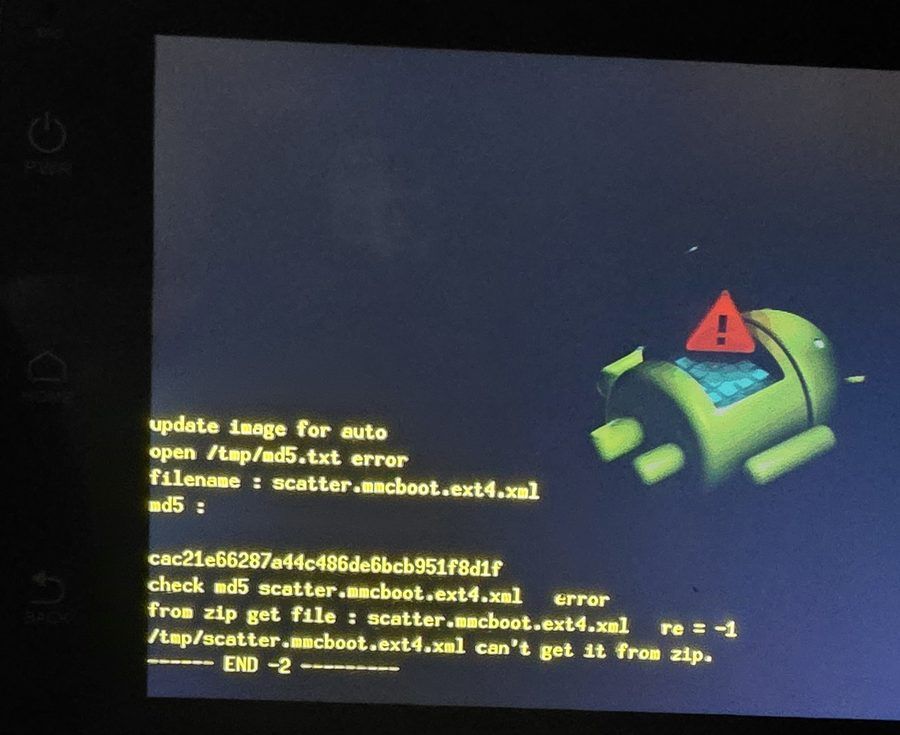

- **Não use** "Update uboot", "Update kernel", "Update recovery", "Update rootfs", "Update logo",
  "Update metazone", "Update dvp" ou "Update arm2" sem saber o que está gravando. Essas opções regravam
  outras partições; **"Update uboot" com arquivo errado pode deixar a central sem ligar de vez**
  (nem o recovery aparece).
- **Não desligue** o carro nem tire o cartão enquanto estiver gravando.
- **Não use** esta imagem em central com outra versão de software (ver [seção 1](#1-qual-central-é-esta)).

---

## 6. Mensagens que podem aparecer

| Mensagem | O que significa | O que fazer |
|---|---|---|
| `Image file isn't exist!!!` | Não achou `system.img.ext4` na raiz do cartão | Confira nome, que está fora de pasta, cartão em FAT32 e título "SD Card" |
| `Update is successful.` | Gravou | Toque em **Reboot system** |
| `Image file is damaged!!!` | Arquivo corrompido | Baixe de novo, confira o MD5, copie de novo |
| `open /tmp/md5.txt error` / `END -2` | Usou "Auto Update" | Use **Update system** |
| Volta ao recovery depois de gravar | O defeito não está na `system` | Procure assistência técnica |
| A central liga, mas fica dando "o launcher parou" | Sistema ou configuração com problema | Tente primeiro o **Factory reset** do recovery (apaga as configurações da central). Se não resolver, regravar a `system` com este guia **pode** resolver, **por sua conta e risco** |

Exemplo de `Image file isn't exist!!!` (arquivo não estava na raiz do cartão):

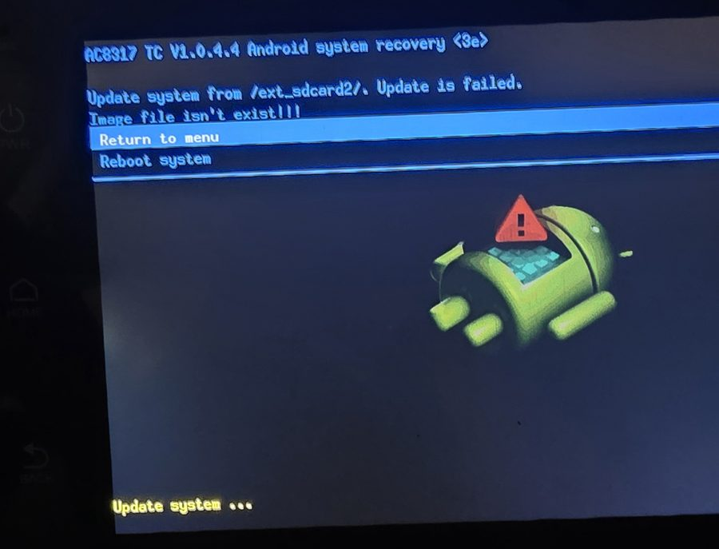

---

## 7. O que essa imagem faz e não faz

**Faz:**
- Regrava **só a partição `system`** (o Android de fábrica, 800 MB) com a original da `V1.0.09R8`.

**Não faz:**
- Não mexe no bootloader, kernel, recovery, logo nem na tabela de partições.
- **Não apaga seus dados**: configurações, celulares pareados, rádios salvas e arquivos ficam em outras
  partições (`data`, `usrdata`), que não são tocadas.
- Não conserta defeito de hardware (memória eMMC com defeito, placa queimada, tela, touch).
- Não atualiza a central para outra versão nem adiciona Android Auto / CarPlay.

Se você tinha instalado apps "por dentro" do sistema (em `/system/app`), eles somem: a `system` volta
a ser exatamente a de fábrica.

---

## 8. Conferência do arquivo (MD5)

| Arquivo | Tamanho | MD5 |
|---|---|---|
| `system.img.ext4.zip` (download) | 357.057.453 bytes | `706f71dfe78af5454297a39090b48608` |
| `system.img.ext4` (descompactado) | 838.870.428 bytes | `00a533a9ce1e038bcbf124156c7178b4` |
| Partição `system` gravada na central | 838.860.800 bytes | `2599852d6cad052892fc0a0b4e444112` |

Windows (PowerShell): `Get-FileHash .\system.img.ext4 -Algorithm MD5`
Linux/macOS: `md5sum system.img.ext4`

---

## 9. Como a imagem foi feita

1. Foi feita uma **cópia byte a byte** (clone com `dd`) da memória interna (eMMC, 15,76 GB) de uma
   central **igual e funcionando**, com a mesma versão `V1.0.09R8`.
2. O MD5 de cada partição do clone foi conferido contra o aparelho: 13 de 13 iguais.
3. Só a partição **`system`** foi publicada. Ela contém **apenas apps de fábrica** (72 APKs: Multilaser/
   Roadrover como `BT`, `RDSRadio`, `BackCar`, `X1CarAssistant`, `EasyConnected`, mais Android e Google
   padrão). **Nenhum dado pessoal**: contas, redes Wi-Fi e celulares pareados ficam na partição `data`,
   que **não** foi publicada.
4. A `system` foi convertida para o formato *sparse* do Android só com blocos RAW (`0xCAC1`), que é o
   formato que a opção "Update system" do recovery aceita, com o script
   [`scripts/fazer_system_img.py`](scripts/fazer_system_img.py).
5. O arquivo gerado foi testado: reconvertido de volta, dá exatamente a `system` original (mesmo MD5),
   e foi gravado com sucesso numa central que estava presa no recovery.

Para gerar você mesmo a partir de um clone ou de uma cópia da partição `system`:

```bash
python scripts/fazer_system_img.py --clone emmc_inteiro.img system.img.ext4
python scripts/fazer_system_img.py --particao system_cru.img system.img.ext4
```

---

## 10. Detalhes técnicos (para quem quer ir além)

Recovery `AC8317 TC V1.0.4.4` (Autochips AC8317, Android 4.2.2, kernel 3.4.35), analisado a partir do
binário `/sbin/recovery`:

- **"Image from U Disk"** só alterna a origem entre cartão SD e pendrive; o título mostra qual está ativa.
  Cartão SD com partição = `/ext_sdcard2/` (`mmcblk1p1`), sem partição = `/ext_sdcard1/`,
  pendrive = `/udisk1/` (`sda`).
- As opções **"Update X"** gravam uma partição lendo `<origem>/<arquivo>` conforme a `recovery.fstab`,
  **sem checar MD5**:

| Opção | Arquivo na raiz do cartão | Partição | Formato |
|---|---|---|---|
| Update system | `system.img.ext4` | system | sparse Android (RAW/DONT_CARE) |
| Update kernel | `uImage` | kernel | raw |
| Update rootfs | `ramdisk.gz` | rootfs | raw |
| Update recovery | `recovery.gz` | recovery | raw |
| Update logo | `logo.mrf` | logo | raw |
| Update metazone | `metazone.bin` | metazone | raw |
| Update dvp | `target.bin` | dvp | raw |
| Update arm2 | `arm2.bin` | arm2 | raw |
| Update uboot | `u-boot.bin` | uboot | raw |

- **"Auto Update"** lê `update/update.img` (zip com `md5.txt`, `scatter.mmcboot.ext4.xml`,
  `recovery.gz` obrigatória e as imagens), mas pelo menu falha porque o `md5.txt` só é extraído para
  `/tmp` quando o recovery é chamado por comando de boot (`update.img_sp`).
- O recovery também tem um mecanismo de patch (`patch.img`, copia `.so` para `/system/lib` e `.apk` para
  `/system/app`), mas ele só roda por comando de boot, não pelo menu.
- Tabela de partições (cmdline do kernel e tabela `PTBL` gravada no eMMC, terminando em `0x3ffe00`):

| Partição | Início | Tamanho | Tipo |
|---|---|---|---|
| preloader | 0x0 | 64 KiB | raw |
| datazone | 0x10000 | 4 KiB | raw |
| uboot | 0x11000 | 0x3ef000 | raw |
| env | 0x400000 | 2 MiB | raw |
| arm2 | 0x600000 | 2 MiB | raw |
| logo | 0x800000 | 4 MiB | raw |
| kernel | 0xc00000 | 4 MiB | raw |
| rootfs | 0x1000000 | 2 MiB | raw |
| system | 0x1200000 | 800 MiB | ext4 |
| data | 0x33200000 | 2000 MiB | ext4 |
| cache | 0xb0200000 | 100 MiB | ext4 |
| recovery | 0xb6600000 | 4 MiB | raw |
| misc | 0xb6a00000 | 2 MiB | raw |
| backup | 0xb6c00000 | 70 MiB | ext4 |
| metazone | 0xbb200000 | 4 MiB | raw |
| dvp | 0xbb600000 | 4 MiB | raw |
| data4write | 0xbba00000 | 2000 MiB | ext4 |
| usrdata | resto | ~10 GiB | vfat (armazenamento interno) |

- A central bloqueia instalação de APK de terceiros (lista fixa de pacotes permitidos no
  `PackageManagerService`); é por isso que ela mostra "O aplicativo não foi instalado".

---

## Apoie este projeto

O Pix para apoiar está [lá no começo do guia](#apoie-este-projeto-pix). Obrigado! 🙏
